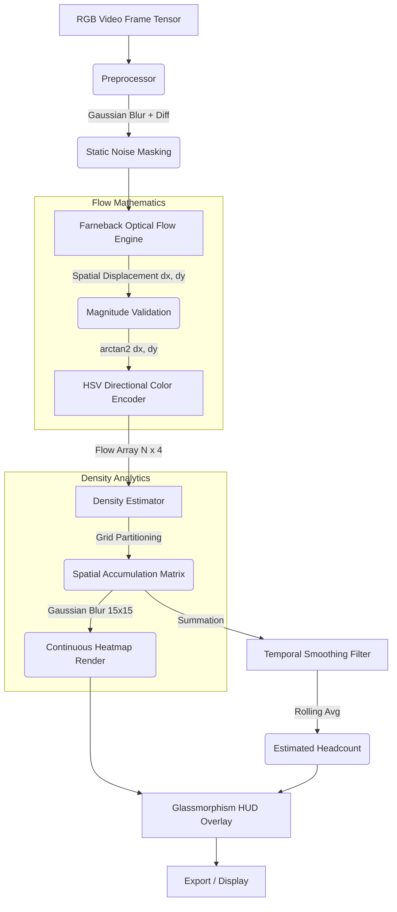

# Deep Technical Architecture Document: Autonomous Crowd Analysis

**Date:** April 2026  
**Project:** Autonomous Crowd Analysis & Density Estimation Pipeline  
**Core Methodology:** Hybrid Architecture integrating YOLOv8 (Sparse) and IEEE 7275777 (Dense Optical Flow).

---

## 1. Executive Summary

This document details the complete end-to-end architecture of the Crowd Analysis system. The system addresses a critical limitation in modern computer vision: Object detecters (like YOLO) fail catastrophically in tightly packed, occluded crowds due to overlapping bounding boxes. 

To resolve this, the system employs a **Dual-Architecture** pipeline:
1.  **Sparse Pipeline (YOLOv8):** Used for low-to-medium density crowds where individual full-body detection is possible.
2.  **Dense Pipeline (Farneback Flow):** Used for massive, occluded crowds. Instead of detecting bodies, it tracks pixel-level motion vectors, applying spatial clustering and directional math to estimate crowd scale.

---

## 2. Codebase Architecture & Data Flow

The project is structured into a modular pipeline located under the `utils/` directory.

### Directory Structure
```text
crowd-analysis/
├── main.py                    # Entry point, CLI parser, and Render Engine (HUD)
├── requirements.txt           # Dependency matrix (OpenCV, NumPy, Ultralytics)
├── utils/
│   ├── config.py              # Centralized hyperparameters & thresholds
│   ├── preprocessing.py       # Frame isolation logic
│   ├── feature_extractor.py   # FAST corner detection
│   ├── optical_flow.py        # LK & Farneback trackers + Directional Math
│   ├── density_estimator.py   # Grid clustering and Gaussian Heatmap logic
│   ├── visualizer.py          # YOLO bounding box utils
│   ├── detector.py            # YOLOv8 integration wrapper
│   └── temporal_visualizer.py # 2x2 Research View buffer
```

### Pipeline Data Flow (Dense Mode)



---

## 3. Mathematical Models & Core Implementations

### 3.1 Preprocessing Isolator
Before tracking motion, static elements (walls, roads) are ignored to save compute.
*   **Math:** $\Delta Frame = \text{abs}(T - (T-1))$
*   **Thresholding:** Pixels with difference $< \tau_{diff}$ are zeroed out.

### 3.2 Dense Farneback Optical Flow
Unlike Lucas-Kanade which tracks sparse FAST corners, Farneback computes motion for *every* pixel by approximating image neighborhoods using polynomial expansion.
*   **Scale parameters:** `pyr_scale=0.5, levels=3, winsize=15`
*   **Vector Matrix:** Returns $V(x,y) = (dx, dy)$.
*   **Magnitude Filtering:** To prevent sensor noise from registering as motion:
    $$||V|| = \sqrt{dx^2 + dy^2}$$
    Vectors are kept only if $||V|| > \text{OF\_MIN\_MOTION}$ (Current config: 0.5 pixels).

### 3.3 Directional Color Encoding (Angle-to-Hue)
To visualize exactly where the crowd is moving, the flow vectors are color-coded based on their trajectory angle using the HSV color space.
*   **Angle Calculation:** $\theta = \text{arctan2}(dy, dx)$ where $\theta \in [-\pi, \pi]$
*   **Normalization to Hue:** OpenCV requires Hue to be in the range $[0, 179]$.
    $$H = \lfloor (\theta + \pi) \times \frac{179}{2\pi} \rfloor$$
*   The resulting Hue is combined with max Saturation and Value to yield a bright, directional BGR color map pointing North/South/East/West.

### 3.4 Density Heatmap & Clustering
The system replaces blocky grids with a continuous, professional heatmap.
1.  **Accumulator Space:** An empty matrix $1/16$th the size of the frame is created.
2.  **Binning:** Vector endpoints are binned into this matrix.
3.  **Gaussian Smoothing:** The accumulator is blurred.
    $$A_{smooth} = \text{Gaussian}(A_{raw}, \sigma=(15,15))$$
4.  **Color Projection:** The array is normalized to $[0, 255]$ and mapped using `cv2.COLORMAP_JET`, creating the vibrant Red (high) to Blue (low) flow overlay.

### 3.5 Temporal Smoothing Filter
Estimation algorithms are inherently jittery. We apply a rolling average to the calculated human count to stabilize UI output.
*   **Equation:** Let $C_t$ be the raw heuristic count at frame $t$.
    $$C_{\text{smooth\_t}} = \frac{1}{W} \sum_{i=0}^{W-1} C_{t-i}$$
*   **Window ($W$):** Defined dynamically as `WAIT_DELAY * 15` frames.

---

## 4. Configuration Matrix (`config.py`)

Every mathematical threshold is abstracted to the `Config` module for deployment-specific tuning.

| Parameter | Current Value | Core Function |
| :--- | :--- | :--- |
| `OF_DENSE_SAMPLE_STEP` | `15` | Rendering resolution. Draws a vector every 15 pixels. |
| `OF_MIN_MOTION` | `0.5` | Rejects micro-movements (camera shake). |
| `OF_VECTORS_PER_PERSON`| `30.0` | **Crucial Calibration factor**. Estimates 1 human per 30 active vectors. Must be tuned per camera angle and typical crowd distance. |
| `OF_GRID_ROWS / COLS` | `4 / 3` | Original spatial grid resolution (Now underlying the heatmap). |
| `WAIT_DELAY` | `1` | Controls rendering loop frame-delay. Higher = Slow-motion playback. |

---

## 5. UI/UX: The Glassmorphism HUD

The visual output relies on a modern presentation layer dynamically rendered over the frames.
*   **Translucent Panels:** Achieved using a black overlay with $0.4$ alpha parameter, creating a dark, smokey background for text.
*   **Real-time Metrics:** Displays "Active Vectors", "Density Score", "Estimated People", and "System FPS".
*   "Researcher View" (`--view grid`): Configurable to render $T_{current}, T_{blurred}, T_{diff},$ and $T_{vectors}$ simultaneously in a $2 \times 2$ grid for system debugging.

---

## 6. Known Limitations & Roadmap

1.  **Uniform Perspective Scaling Limitation:** The current divisor (`OF_VECTORS_PER_PERSON = 30`) assumes all humans appear at the same scale. In reality, a human close to the camera generates 100 vectors, while a human 50 meters away generates 5. 
    *   *Solution:* Implement a Perspective Matrix (Perspective Transform) that weights motion vectors based on their $Y$-coordinate height on the screen.
2.  **Night-time Degradation:** Optical Flow relies on heavy contrast gradients. At night under poor lighting, the Farneback tracker will lose fidelity.
    *   *Solution:* Pre-process frames using Histogram Equalization (CLAHE) before passing them to the tracking engine.
